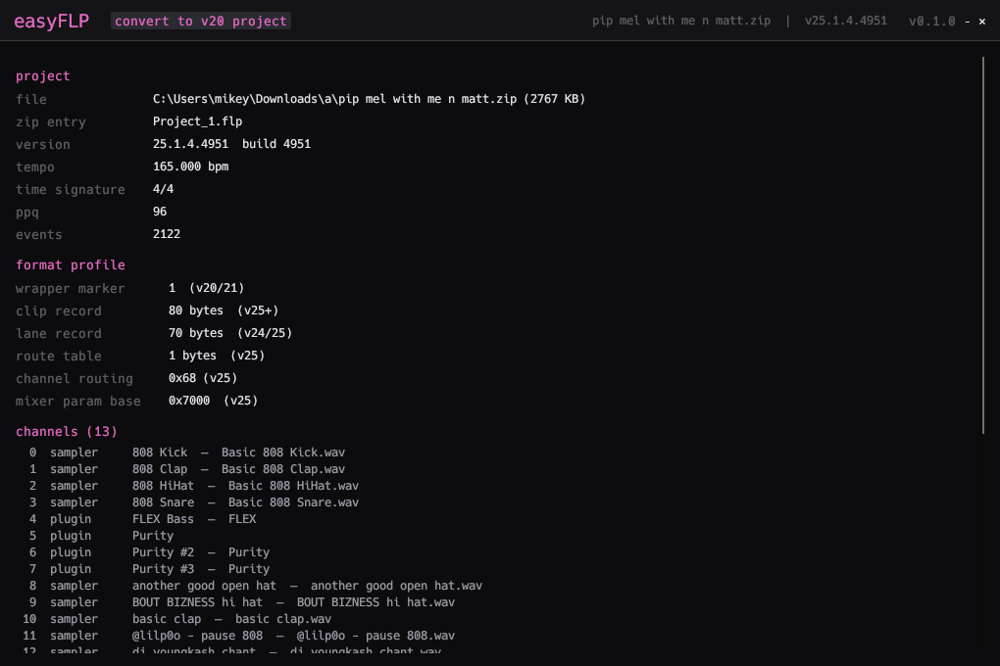
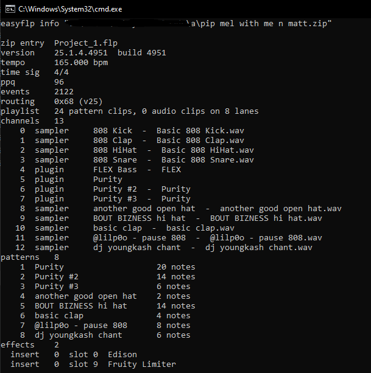

# easyFLP

a `.flp` viewer & backport utility for 🥭 version `20.0.5` *(2018)*

this is a **work in progress** project, and may have bugs.

## install

download `easyflp-setup.exe` from the [latest release](https://github.com/mjkzy/easyflp/releases/tag/latest) and run it. easyflp then opens from the start menu. no admin rights needed. `easyflp.exe` on the same page is the portable app, with no install.

## how to use

1. open easyflp from the start menu (or run `build_and_run.bat` to build, kill the previous process, and run)
2. drop a `.flp`, a `.fst` preset (mixer, channel or plugin state) or a `.zip` containing a FLP file onto the box, or click it to open file explorer
3. if you want to convert the project to version `20.0.5`, click the **convert to v20 project** button
4. the **⚠ convert to v10 project** button writes a `10.0.9` project instead. the inserts above 99, effect slots 9-10, send levels, clip fades and plugin states do not convert well

the converted file is written next to the input project as `<name>_easy.flp` (`<name>_easy10.flp` for the v10 profile). a `.fst` input keeps the `.fst` extension. for a `.zip` looped package, the output is `<name>_easy.zip` with the converted `.flp` and all other files unchanged.

<p align="center">
  
</p>

## build

1. install Rust from https://rustup.rs
2. run `build.bat` or `build_and_run.bat` on windows, `build.sh` or `build_and_run.sh` on linux, or `cargo build --release` on mac.
3. for the installer, install [Inno Setup 6](https://jrsoftware.org/isdl.php) and run `build_installer.bat`. the output is `target/installer/easyflp-setup.exe`.

## cli

`easyflp.exe` is the app. `easyflp-cli.exe` is the command line tool, for terminals and scripts. the installer includes it and can add it to PATH. usage:

```
easyflp-cli info <file.flp|file.fst|file.zip>     print project information
easyflp-cli convert <file.flp|file.fst|file.zip>  write <name>_easy (v20.0.5) next to the input
easyflp-cli convert --fl10 <file>                 write <name>_easy10 (v10.0.9) — experimental
easyflp-cli gui [file]                            launch the graphical app (easyflp)
```

<p align="center">
  
</p>

## how it works

the converter rewrites the event stream to the byte-verified *20.0.5* profile. it runs in two stages: the *20.8* transform first, then the *20.8* to *20.0.5* post-pass. it does not touch note data, plugin states, or sample references. see [FORMAT.md](FORMAT.md) for the full transform tables and their research.

tldr:
- rewrites the version to `20.0.5.681` specifically
- convert *25* channel routing (`0x68`) to the *20* form (`0x16`)
- rewrites playlist clip records to the *20* layout
- truncates lane and channel records to the *20.0.5* lengths and drops the wrapper host chunk

the v10 profile runs the *20.8* transform first, then rewrites the stream into the *10.0.9* layout: ANSI strings, the 105-strip mixer with its four send buses, 32-byte clips on lanes `99 - track`, 8 effect slots, and FL 10's wrapper/native plugin state versions. the legacy fruity effects (blood overdrive, reeverb, phaser, chorus, balance) are re-wrapped as the VST DLLs FL 10 ships. see [FORMAT.md](FORMAT.md) for the table.

## contributing

the best way is to differentiate two `.flp` files by first creating one in version *20.0.5* of the program or earlier, and then opening that **same project** in version *25* or newer of the program (or your version of choice). doing this and saving both projects as `.flp` will allow you to do research of both files. 

if you are using AI to assist you, or a AI agent doing this yourself, read the **AGENTS.md** file on how to contribute to the reverse engineering more in depth with context. opcodes may need more research in the future in order to show more information or convert stuff properly backwards if you see any bugs/problems.
